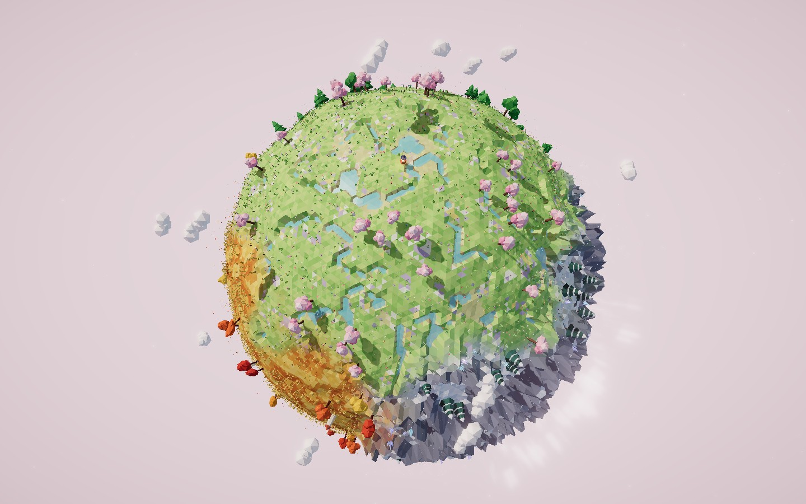

# 摸鱼工坊 · Moyu Creative Lab

一个把 AI 创作成品、可运行源码和提示词档案放在一起的静态作品展厅。

[在线作品集](https://lab.myapi.pw/) · [GitHub 仓库](https://github.com/0xzcboy/moyu-workshop)

收录三件真实作品；提示词为按成品重建的复现参考，并非历史原始输入。**只有展厅新编写的代码采用 MIT；原始作品、提示词、封面和品牌 Logo 不包含在 MIT 授权中。** 查看源码不等于获得再分发或商用许可。



## 本地预览

需要 Node.js 24 和 npm（准备脚本使用 Node 内置 TypeScript 类型擦除）。

```sh
git clone https://github.com/0xzcboy/moyu-workshop.git
cd moyu-workshop
npm ci
npm run dev
```

终端显示本地网址，默认 `http://127.0.0.1:4321/`。不要双击 `dist/index.html`，需要 HTTP 服务。

```sh
npm run build
npm run preview
```

构建输出在 `dist/`。首页不启动 WebGL，不加载远程字体或第三方脚本。三维演示独立打开，Three.js 依赖随站点发布，运行无需访问 unpkg。

## 已收录

| 作品 | 形式 | 提示词状态 |
| --- | --- | --- |
| 四季掌心星球 | Three.js 交互世界 | 按成品重建，非原始记录 |
| 金门大桥 | Three.js 实时场景 | 按成品重建，非原始记录 |
| 雨中站台 | Canvas / Web Audio 十秒动画 | 按成品重建，非原始记录 |

三维作品在电脑端体验较完整；星球原作依赖键盘行走，金门大桥原作面板较宽。展厅本身已适配手机，但没有擅自重写原作品的触屏控制。

## 修改名称与添加作品

- 站点名称、描述、GitHub 入口：`src/lib/site.ts`。
- 品牌图标：`public/logo.png`，原样复用作者的小鱼 Logo，页头、页脚与浏览器图标共用。
- 作品内容、提示词、标签和归档说明：`src/data/works.ts`。每件作品一条记录；详情页由数据自动生成。
- 作品原始源码：`projects/<slug>/index.html`。
- 实际运行封面：`public/covers/<slug>.jpg`。
- 展厅样式：`src/styles/global.css`。

添加作品后，在首页分类按钮与页头数量中同步更新分类和件数；准备脚本会自动生成演示、源码下载和 Markdown 提示词下载。目前准备脚本只针对单文件 HTML 作品，若有相对引用素材，应先扩展脚本复制同目录素材。

所有演示链接显式包含 `index.html`，兼容 Astro 开发服务和静态托管。归档源码保持原样；准备脚本只把生成演示里的固定 Three.js 0.160.0 CDN 地址换成本地路径。其他依赖不会自动转换，需要单独检查。

有原始提示词时，将其与重建版本分开保存，补全模型和日期证据，再更新页面来源标签；不要只替换文本却继续使用错误标签。

## 发布到 GitHub Pages

1. 原仓库为 `0xzcboy/moyu-workshop`，更新前检查素材和敏感信息。若另行授权原作品、提示词或封面，同步更新 `LICENSE`、`THIRD_PARTY_NOTICES.md` 和页面说明。
2. 推送项目到 `main` 分支（不要上传 `node_modules/`、`.env` 或私密素材）。
3. 仓库 Settings → Pages 的 Source 应为 GitHub Actions。
4. 执行 `.github/workflows/pages.yml`。工作流从 Pages 配置取得域名和子路径，适配用户主页及项目仓库路径；自动生成 GitHub 入口。
5. 发布后验证首页、三个详情页、独立演示、源码下载和提示词复制。部署进度见仓库 Actions。

本地模拟项目仓库路径：

```powershell
$env:BASE_PATH = '/moyu-workshop'
$env:SITE_URL = 'https://example.invalid'
npm run build
npm run preview -- --port 4322
```

访问 `http://127.0.0.1:4322/moyu-workshop/`。完成后清除环境变量并重建本地根路径版本：

```powershell
Remove-Item Env:BASE_PATH, Env:SITE_URL -ErrorAction SilentlyContinue
npm run build
```

若要自定义域名，在 GitHub Pages 配置域名，并按其要求设置 DNS。无需新增数据库、后台或模型 API Key。

## 测试与封面

浏览器测试默认使用已安装的 Microsoft Edge：

```sh
npm test
npm run capture:covers
```

截封面前先运行开发服务。截图脚本在浏览器会话中隐藏 HUD，星球仅拍摄时拉远镜头，不修改 `projects/`。若测试环境没有 Edge，请调整 `playwright.config.ts` 和截图脚本中的 channel。

测试覆盖分类恢复、三件作品的资源和来源标签、复制成功与失败提示、手机无横向溢出、首页无三维实例及外部资源。在线演示的实时画面另通过截图脚本检查运行错误。

## 目录与授权

```text
src/data/works.ts           作品资料与复现参考
src/pages/                 首页、详情页、关于页、404
projects/                  原样归档源码
public/covers/             实际运行截图
scripts/prepare-demos.mjs   生成本地依赖演示与下载
scripts/capture-covers.mjs  真实浏览器截封面
tests/                     浏览器回归测试
.github/workflows/          Pages 自动部署
```

新编写的展厅代码采用 MIT；原作品、提示词、封面暂不包含在该授权内。具体边界见 `LICENSE` 和 `THIRD_PARTY_NOTICES.md`。
